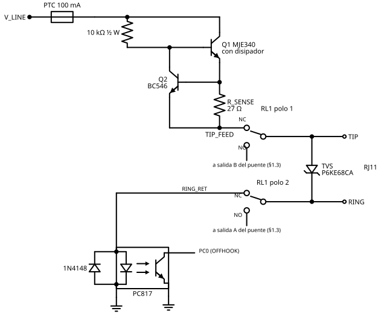

# Prueba de banco: línea discreta contra el Commodore Modem 1200

Esta prueba se hace **antes de diseñar el PCB** (spec §8). Se arma en protoboard o en placa
perforada y responde cuatro preguntas:

1. ¿El descolgado se detecta bien?
2. ¿El Modem 1200 (1670) detecta nuestra ring y atiende solo?
3. ¿El ring trip funciona?
4. ¿Dos módems negocian a 1200 bps a través del acople por capacitor?

Los resultados fijan `V_LINE`, la tensión de ring y la opción de acople del plan de KiCad.

Para que suene L1 alguien tiene que llamar desde L2, así que en la práctica se arman **las
dos líneas**:
- **L1:** el Modem 1200 con `ATS0=1`, que es el llamado.
- **L2:** el módem de la PC o un teléfono común, que es el que llama.

El firmware es el de `firmware/`, sin cambios. Mapa de pines en `firmware/README.md`.

---

## 1. Circuito de prueba y lista de materiales

Todos los valores son **de partida**: la idea de la prueba es ajustarlos. Todos los
componentes son pasantes.

Los esquemáticos se generan con `docs/schematics/make_schematics.py` (Schemdraw). Para
regenerarlos: `pip install schemdraw matplotlib` y después `python3 docs/schematics/make_schematics.py`.

### 1.0 Armado rápido con módulos (recomendado para la prueba)

Para la prueba conviene reemplazar las partes delicadas de armar en protoboard por módulos
comprados armados. En la versión final todo va soldado en la placa, pero el circuito y el
firmware son los mismos.

| Módulo | Reemplaza a | Cómo se conecta |
|---|---|---|
| **Arduino Uno** | ATmega328P, cristal, capacitores, 7805 | Mismo firmware. Pines: tabla de `firmware/README.md` (A0–A5, D2–D10, D12). Se alimenta con los 12 V por su jack; su pin 5V alimenta el módulo MT8870. Masa común con todo. |
| **Elevador 1200 W** (entrada 10–60 V, salida 12–83 V, capacitores de salida de 100 V) | Elevador de §1.1 | Entrada a los 12 V. Ajustar la salida **sin carga**, con el téster, a 24 / 36 / 48 V. Preset **CC** al mínimo. **Nunca más de 60 V** (TVS de 68 V y capacitores de 63 V). |
| **Módulo MT8870** (trae el chip, el cristal y la red de entrada) | MT8870 de L2 | Solo en **L2**, que es la que marca en la prueba. `IN` al nodo de audio protegido de L2; `StQ` a **D7**; `Q1`–`Q4` a **A2–A5**; `VCC` a 5 V. Su `TOE` está fijo en alto: **no se pueden poner dos en el mismo bus**. Para L1 no hace falta (el Modem 1200 atiende, no marca). |
| **3 relés HK19F-DC12V-SHG** (DPDT, bobina 12 V) + **ULN2003A** | — (son los de §1.3 y §1.4) | Ring L1 desde **D8**, ring L2 desde **D9**, unión desde **D10**, a través del ULN2003A. Patas en grilla de 2,54 mm: entran en el protoboard. |
| **Fuente de pared 12 V 2 A** | — | Ficha 5,5 × 2,1 mm. Una más chica puede caer al arrancar el elevador y sus capacitores. |

- **Alternativa a los HK19F:** módulos de relé SRD de 12 V con jumper en H. Son de un polo:
  hacen falta **dos por línea** para la ring (los dos IN al mismo pin) y uno para la unión.
  Verificar que no se activen mientras el Uno se reinicia; si se activan, 10 kΩ de IN a GND.
- **Llave AR/US:** entre **D12** y GND, **con 1 kΩ en serie**. Abierta = AR.
- **Monitor serie:** con el Uno conectado por USB, `screen /dev/cu.usbmodemXXXX 38400` muestra
  cada descuelgue, dígito y cambio de estado. Ver `firmware/README.md`.
- **El Uno no tiene protecciones propias:** entre las líneas y sus pines tienen que estar
  siempre el PC817 y la protección de 1 kΩ + diodos del audio (§1.4).

### 1.1 Alimentación

```
 12 V (fuente de pared) ──┬──► 7805 ──► +5 V (ATmega, MT8870, lógica)   [con Arduino Uno: su regulador]
                          ├──► COM del ULN2003A y bobinas de los relés
                          └──► elevador ajustable ──► V_LINE (24 / 36 / 48 V)
                                                      │
                                                      ├─ 4,7 kΩ 1 W a GND (descarga)
                                                      └─ 100 µF 63 V
```

Para la prueba conviene un **módulo elevador ajustable** comprado armado, cuya salida llegue a
50 V. Hay que verificar en la publicación la tensión máxima de salida, porque muchos módulos
baratos no pasan de 35 V. El elevador propio de la placa final (por ejemplo, un MC34063 con un
MOSFET externo de 100 V) se diseña después, con la `V_LINE` que salga de acá.

### 1.2 Alimentación de una línea (por cada línea)



El relé RL1 está dibujado **en reposo**: los dos polos tocan el contacto NC, y la línea queda
alimentada por el limitador. Al activarse, los dos polos pasan a NO y la línea queda
conectada a las salidas A y B del puente H (§1.3).

- **Limitador de corriente:** Q1 conduce hasta que la caída en R_SENSE llega a unos 0,65 V.
  Con 27 Ω la corriente queda en unos **24 mA**. Para 30 mA usar 22 Ω; para 20 mA, 33 Ω.
- Con la línea en corto, Q1 disipa `V_LINE × I`, unos 1,2 W a 48 V: **necesita disipador**.
  La resistencia de base disipa unos 0,22 W: tiene que ser de **1/2 W**.
- **El PC817 va en el retorno (RING → GND), no en la alimentación.** Así por el LED pasa
  solamente la corriente que atraviesa el módem. La corriente que recarga el capacitor de
  acople (§1.4) no pasa por el LED, y no aparecen descuelgues falsos al terminar cada ráfaga
  de ring ni pulsos acortados al marcar por pulsos.
- **PC817:** el transistor va con el colector a **PC0** (pull-up interno del ATmega) y el
  emisor a GND. Lazo cerrado = PC0 en bajo, que es lo que espera el firmware.

### 1.3 Ring

En la prueba se usa **el mismo `V_LINE` como riel de ring**. Un puente H lo aplica a la
línea con polaridad alternada, así que a la línea llega una onda cuadrada de ±V_LINE, unos
48 V rms a 48 V.


Las gates se excitan así:


- **Relé de ring:** DPDT con bobina de 12 V (por ejemplo, de la serie HK19F). Lo maneja una
  entrada del ULN2003A desde **PB0** (L1) o **PB1** (L2). El pin COM del ULN2003A va a 12 V
  y ya trae los diodos de protección.
  - En reposo (NC), la línea queda en la alimentación de §1.2.
  - Activado (NO), la línea queda en el puente H.
- **R_BRIDGE está entre `V_LINE` y el lado alto del puente.** Así limita la corriente tanto
  si la línea está en corto como si P y N de la misma rama conducen a la vez (unos 100 mA
  como máximo a 48 V). Por eso no puede ir solo en la salida.
- **Gates de los N:** cada una lleva 220 Ω en serie con un 1N4148 en paralelo (cátodo hacia
  el driver), para que apague rápido y prenda lento, y 10 kΩ de gate a fuente como pull-down.
- **Gates de los P:** cada una tiene su desplazador. Los 22 kΩ mantienen la gate en
  `V_LINE` (P apagado). Cuando el BC546 conduce, baja la gate, y el zener de 12 V limita Vgs.
  **La resistencia de 10 kΩ en serie es obligatoria:** sin ella, el zener conduciría
  (48 − 12) / 220 ≈ 160 mA y se quemaría. Con 10 kΩ conduce unos 3,6 mA.
- **El desplazador invierte:** BC546 encendido = P encendido. Por eso PD4 en alto enciende P1
  y N2, y el inversor enciende P2 y N1.
- **PD4 tiene un pull-down de 10 kΩ,** que fija el puente en un estado conocido durante el
  reset y mientras se graba por ISP.
- **Verificar con el osciloscopio**, sin línea conectada: medir la tensión sobre R_BRIDGE en
  cada cambio de fase. Si aparecen picos de conducción cruzada de más de unos microsegundos,
  aumentar la resistencia de 220 Ω de las gates de los N.
- Si a 48 V el Modem 1200 no detecta la ring, ver el plan B en §1.6.

### 1.4 Audio, tonos y DTMF (acople por capacitor)

```
 nodo TIP_FEED (lado NC del relé: nunca ve la ring)
   └── 2,2 µF 250 V film ── nodo de audio de la línea (lado línea)
                              │
                              ├── relé de unión L1–L2 (ULN2003A desde PB2) ── nodo de audio de la otra línea
                              │
                              └── 1 kΩ ──┬── 1N4148 a +5 V (cátodo a +5 V)
                                         ├── 1N4148 a GND (ánodo a GND)
                                         └── nodo de audio protegido (lado lógica, 0–5 V)

 PD6 (L1) o PD5 (L2) ── 1 kΩ ─┬─ 1 kΩ ─┬─ 4,7 kΩ fijo ── trimmer 47 kΩ ──► nodo protegido
                            47 nF     47 nF
                              GND      GND            (filtro RC de 2 polos, ~3 kHz)

 nodo protegido (de cada línea) ── 100 nF ── 100 kΩ ── IN- del MT8870 de esa línea
                                   (circuito de entrada de una sola terminal de la hoja de datos)

 MT8870 L1: Q1–Q4 ── 1 kΩ c/u ──┬── PC2–PC5 (bus compartido)    StD ──► PD2, y StD ──► TOE
 MT8870 L2: Q1–Q4 ── 1 kΩ c/u ──┘                               StD ──► PD7, y StD ──► TOE
```

- **El capacitor de acople va del lado NC del relé de ring.** Así nunca le llega la ring y
  mantiene su carga.
- **Del lado de la lógica, todo queda protegido por la resistencia de 1 kΩ y los dos diodos
  a +5 V y GND.** Así los escalones de continua de cada descuelgue, cuelgue y pulso (unos
  ±40 V) no llegan al MT8870 ni a los pines del ATmega.
- **Un MT8870 por línea, sin selector.** El `TOE` de cada chip va unido a su `StD`: cada
  chip maneja el bus Q solo mientras tiene un dígito. Las resistencias de 1 kΩ en serie
  protegen a los dos chips si marcan exactamente al mismo tiempo; en ese caso el firmware
  descarta el dígito.
- La resistencia fija de 4,7 kΩ en serie con el trimmer protege a PD5 y PD6 aunque el
  trimmer se ponga en cero.
- La unión L1–L2 va del lado línea, antes de la protección, para que el audio de los módems
  pase sin atenuación.
- El nivel del tono se ajusta con el trimmer. Hay que empezar alto, en unos 47 kΩ, y bajarlo
  hasta que el módem detecte el tono de invitación, para no saturar la línea.
- **MT8870:** usar el circuito de entrada de una sola terminal y el cristal de 3,579545 MHz
  de la hoja de datos. Los dos chips pueden compartir un solo cristal: la hoja de datos
  muestra cómo la salida OSC2 de uno alimenta la entrada OSC1 del otro. Confirmarlo en la
  prueba; si no arranca bien, usar un cristal por chip.
- Para la alternativa con **transformador 600:600**: reemplazar el capacitor de 2,2 µF por el
  bobinado de línea del transformador, en serie con un capacitor de 1 µF 250 V para que no
  pase la continua. El otro bobinado va al nodo de audio. La protección de 1 kΩ y los
  diodos se mantiene.

### 1.5 Lista de materiales

Los componentes "por línea" se multiplican por 2. Los "compartidos" van una sola vez.

| Cant. | Componente | Uso |
|---|---|---|
| 1 | Módulo elevador ajustable de 12 V a ≥ 50 V | compartido; solo para la prueba |
| 1 | 7805 + capacitores de 100 nF y 10 µF | compartido |
| 1 | ATmega328P DIP-28 + cristal de 16 MHz + 2 × 22 pF | compartido |
| 1 | MT8870 DIP-18 + componentes de entrada de la hoja de datos | por línea |
| 1 | cristal de 3,579545 MHz | compartido entre los dos MT8870 (o uno por chip) |
| 4 | resistencia de 1 kΩ | por línea (salidas Q1–Q4 del MT8870) |
| 1 | ULN2003A DIP-16 | compartido (ring L1, ring L2, unión) |
| 1 | MJE340 + disipador chico | por línea |
| 1 | BC546 | por línea (limitador) |
| 1 | resistencia de 27 Ω (y 22 Ω y 33 Ω para probar) | por línea |
| 1 | resistencia de 10 kΩ 1/2 W | por línea |
| 1 | PTC de 100 mA y 60 V o más | por línea |
| 1 | TVS P6KE68CA | por línea |
| 1 | PC817 + 1N4148 | por línea |
| 1 | relé DPDT con bobina de 12 V | por línea (ring) |
| 1 | capacitor de film de 2,2 µF 250 V | por línea (con 1 µF se pierden 1–2 dB entre las dos líneas) |
| 1 | resistencia de 1 kΩ + 2 × 1N4148 | por línea (protección del audio) |
| 1 | trimmer de 47 kΩ + 4,7 kΩ + 2 × 1 kΩ + 2 × 47 nF | por línea (filtro y nivel de tono) |
| 1 | RJ11 hembra pasante | por línea |
| 2 | IRF540 | compartido (puente H) |
| 2 | IRF9540 | compartido (puente H) |
| 2 | BC546 o MPSA42 + 22 kΩ + zener de 12 V + 10 kΩ (serie) + 10 kΩ (base), por cada uno | compartido (desplazadores de P1 y P2) |
| 1 | BC547 + 10 kΩ + 4,7 kΩ | compartido (inversor de fase) |
| 2 | resistencia de 220 Ω + 1N4148 | compartido (gates de N1 y N2) |
| 3 | resistencia de 10 kΩ | compartido (pull-down de PD4 y de las gates de los N) |
| 1 | resistencia de 470 Ω 5 W | compartido (R_BRIDGE) |
| 1 | relé chico con bobina de 12 V | compartido (unión L1–L2) |
| 1 | resistencia de 4,7 kΩ 1 W (descarga) + capacitor de 100 µF 63 V | compartido (riel V_LINE; el capacitor no hace falta con el elevador de 1200 W, que trae los suyos) |
| 1 | LED + resistencia de 470 Ω | compartido (LED_CALL en PD3) |
| 1 | transformador 600:600 (opcional) | solo si falla la validación 4 |

### 1.6 Plan B: riel de ring aparte de 70–90 V

Usarlo solo si la validación 2 falla a 48 V. **Supera la tensión de seguridad extra-baja**
(unos 60 V de continua), así que todo lo de §2 se aplica con más cuidado todavía.

Hay que cambiar estos componentes:

| Componente | Prueba a 48 V | Plan B a 90 V |
|---|---|---|
| Elevador | compartido con V_LINE | segundo elevador solo para la ring, de 70–90 V |
| MOSFETs del puente | IRF540 / IRF9540 (100 V) | IRF640 / IRF9640 (200 V) |
| Desplazadores de gate | BC546 / MPSA42, 22 kΩ, 10 kΩ en serie | MPSA42 (300 V), 47 kΩ 1 W, 22 kΩ 1 W en serie |
| R_BRIDGE | 470 Ω 5 W | 1 kΩ 10 W (unos 8 W en corto a 90 V) |
| TVS de línea | P6KE68CA | P6KE120CA (la de 68 V conduciría con la ring y se quemaría) |
| Capacitor de acople | 250 V | 250 V (alcanza) |
| Capacitor del riel | 63 V | 160 V o más |

---

## 2. Seguridad

- **Nodos con tensión peligrosa:**
  - el riel `V_LINE`;
  - las salidas del puente H y R_BRIDGE;
  - los contactos NO de los relés de ring;
  - los RJ11;
  - los capacitores de acople de 250 V.
- **Nunca se toca nada con la ring activa,** es decir, mientras se escucha el clic del relé
  de ring o mientras el módem llamador recibe tono de llamada. ±48 V en cuadrada no mata, pero duele.
- **Los capacitores quedan cargados.** Los del riel (los 3 × 470 µF del elevador de 1200 W,
  unos 1,6 J a 48 V) se descargan solos por la resistencia de 4,7 kΩ en unos 30 s. Esperar
  ese tiempo, y medir con el téster, antes de tocar. Los de 2,2 µF de acople hay que descargarlos con una
  resistencia de 1 kΩ antes de tocarlos.
- **Siempre con la fuente de pared de 12 V.** Nada se conecta a 220 V.
- **Primero sin módems:** medir con el téster que `V_LINE` y la corriente de corto sean las
  esperadas. Recién después se conectan las computadoras.
- **Disipador en el MJE340** antes de probar con la línea en corto.

---

## 3. Procedimiento

Antes de empezar:
- Grabar el firmware: con un ATmega solo, `make -C firmware fuses flash`; con el Arduino Uno,
  `make -C firmware flash PROGRAMMER=arduino PORT=/dev/cu.usbmodemXXXX` (sin `fuses`).
- Llave AR/US en **AR** (abierta).
- Abrir el monitor serie a 38400 (`screen /dev/cu.usbmodemXXXX 38400`): cada evento aparece
  ahí y sirve para registrar los resultados.
- Configurar el Modem 1200 desde la terminal de la C64.

### Validación 1: descolgado

1. Con `V_LINE = 24 V`, conectar el Modem 1200 a L1.
2. Desde la terminal, enviar `ATH1` (descolgar) y después `ATH0` (colgar). Repetir 10 veces.
3. En el monitor serie aparecen `L1 off-hook` con `ATH1` y `L1 on-hook` con `ATH0`. También
   se puede escuchar la línea (con `ATH1` aparece el tono de invitación de 425 Hz) o medir
   PC0 (A0 en el Uno) con el osciloscopio.
4. Repetir con 36 V y con 48 V.

**Criterio de éxito:** 10 de 10 descuelgues y 10 de 10 cuelgues detectados para cada
`V_LINE`. Registrar además la corriente de lazo medida con el módem descolgado.

### Validación 2: ring

1. Modem 1200 en L1 con `ATS0=1`.
2. Desde L2 (el módem de la PC con `ATDT1`, o un teléfono), marcar cualquier número.
3. A los 2,5 s del último dígito, L1 tiene que sonar con cadencia de 1 s on y 4 s off.
4. Medir la tensión de ring en el RJ11 de L1 con el téster en alterna (V rms) mientras suena.

**Criterio de éxito:** el Modem 1200 atiende (va a línea y emite el tono de respuesta) en
5 de 5 llamadas. Registrar los V rms de ring medidos. Si no atiende, pasar al plan B de §1.6.
5. Repetir una vez marcando por pulsos desde la PC (`ATDP1`) para verificar el marcado por pulsos.

### Validación 3: ring trip

1. Igual que la validación 2.
2. Observar qué pasa cuando el Modem 1200 atiende.

**Criterio de éxito:** en 5 de 5 llamadas se cumplen las tres cosas:
- la ring se corta antes de que empiece la ráfaga siguiente (no hay una segunda ráfaga
  después de atender);
- se enciende el LED de llamada activa (PD3);
- se cierra el relé de unión.

Además, en el osciloscopio, PC0 de L1 no tiene que bajar durante los 200 ms siguientes a
cada ráfaga cuando el módem todavía no atendió (si baja, hay un descuelgue falso).

### Validación 4: negociación a 1200 bps

1. Modem 1200 en L1 con `ATS0=1`, y módem de la PC en L2.
2. Desde la PC: `ATDT1`.
3. Esperar `CONNECT 1200` en las dos terminales.
4. Escribir o pegar texto en las dos direcciones durante 10 minutos.

**Criterio de éxito:** `CONNECT 1200` en 5 de 5 intentos, y 10 minutos de texto sin
caracteres basura visibles. Si falla, se arma la alternativa con transformador 600:600
(§1.4), se repite la validación y se registra el resultado.

---

## 4. Resultados

Una fila por corrida. Se commitea completa en el repo.

| Fecha | V_LINE (V) | I lazo (mA) | Ring (V rms) | V1 descolgado (x/10) | V2 ring (x/5) | V3 ring trip (x/5) | V4 negociación (x/5) | Acople | Observaciones |
|---|---|---|---|---|---|---|---|---|---|
| | 24 | | | | | | | capacitor | |
| | 36 | | | | | | | capacitor | |
| | 48 | | | | | | | capacitor | |
| | | | | | | | | transformador | (solo si falla V4) |

**Decisiones para el plan de KiCad**, a completar con la tabla de arriba:

- `V_LINE` elegido:
- Riel de ring: compartido con `V_LINE` o con elevador aparte, y de cuántos voltios:
- Acople: capacitor o transformador:
- R_SENSE (corriente de lazo):
- Nivel del tono (valor del trimmer):
